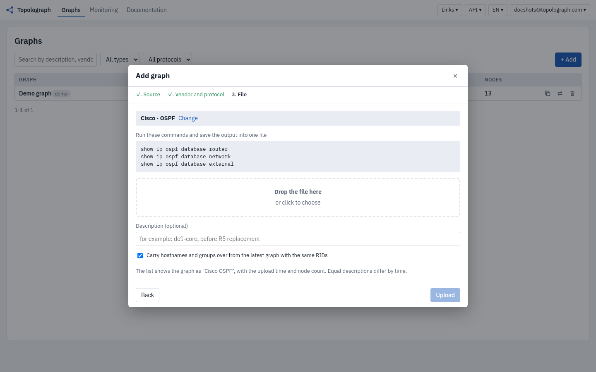
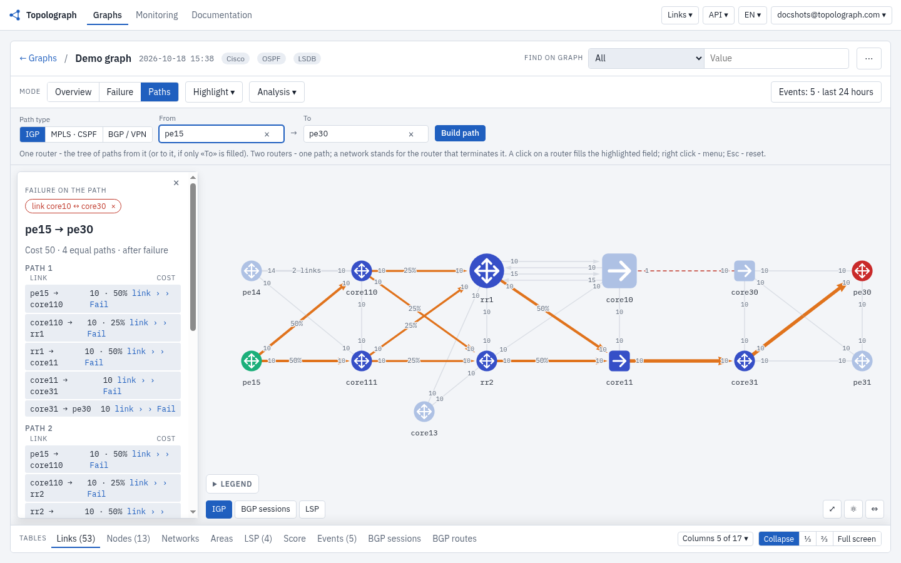

# Topolograph

*Topolograph · routing analysis for network operations*

## Your network, as its protocols see it

Topolograph builds a model of the network from what its routing protocols report: OSPF, OSPFv3, IS-IS and BGP/EVPN. Primary and backup paths, links with no backup, search over network elements (prefixes, MAC addresses and more), and link or node failures simulated before maintenance starts are all computed on that model.

[Interactive demo](https://topolograph.com/graphs?demo=1) · [Self-host with Docker](https://github.com/Vadims06/topolograph-docker) · [Docs](https://docs.topolograph.com)


## Get the LSDB

Topolograph builds the graph from the LSDB of one router per area or level. Run the commands for your vendor, save the output to one text file and upload it.

| Vendor | OSPFv2 | OSPFv3 | IS-IS |
|---|---|---|---|
| Allied Telesis | `show ip ospf database {router\|network\|external}` |  |  |
| Arista |  | `show ipv6 ospf database detail` |  |
| Bird | `show ospf state all` |  |  |
| Cisco | `show ip ospf database {router\|network\|external}` |  | `show isis database detail` |
| Cisco NX-OS | `show ip ospf database {router\|network\|external} detail` |  |  |
| Ericsson | `show ospf database {router\|network\|external} detail` |  |  |
| Extreme | `show ospf lsdb detail lstype {router\|network\|as-external}` |  |  |
| Fortinet | `get router info ospf database {router\|network\|external} lsa` | `get router info6 ospf database router`, `network`, `external`, `intra-prefix` | `get router info isis database detail` |
| FRRouting | `show ip ospf database {router\|network\|external}` |  | `show isis database detail` |
| Huawei | `display ospf lsdb {router\|network\|ase}` |  | `display isis lsdb verbose` |
| IP Infusion OcNOS | `show ip ospf database {router\|network\|external}` | `show ipv6 ospf database router`, `network`, `external`, `intra-prefix` | `show isis database verbose` |
| Juniper | `show ospf database {router\|network\|external} extensive \| no-more` |  | `show isis database extensive` |
| MikroTik | `/routing ospf lsa print detail file=lsa.txt` | `/routing/ospf/lsa/print detail without-paging where instance=v3` | `/routing/isis/lsp/print detail without-paging` |
| Nokia | `show router ospf database type {router\|network\|external} detail` |  | `show router isis database detail` |
| Palo Alto | `show routing protocol ospf dumplsdb` |  |  |
| Quagga | `show ip ospf database {router\|network\|external}` |  |  |
| Ruckus | `show ip ospf database link-state router`, `show ip ospf database link-state network`, `show ip ospf database external-link-state` |  |  |
| Ubiquiti | `show ip ospf database {router\|network\|external}` |  |  |
| ZTE |  |  | `show isis database verbose` |

For TE attributes (bandwidth, TE metric, admin groups), append `show ip ospf database opaque-area` (OSPF) or use the detail/verbose IS-IS output. Notes per vendor, TE attributes and supported RFCs: [supported vendors](https://docs.topolograph.com/reference/supported-vendors/).

## Snapshot and analysis

Upload the file in the UI (Add, LSDB), pick the vendor and the protocol, or send it through the API. The snapshot is analysed offline, without access to the routers.

 

On the snapshot: path calculation, search over network elements, maintenance planning. In the demo network (13 routers, 26 links) the pe15 to pe30 path has cost 41 and four equal-cost paths.


Switching off the core10 to core30 link on the model recalculates SPF: traffic moves to core11 to core31, the cost goes from 41 to 50, and there are still four paths. The real network is not touched.



*Paths mode: Fail on a link of the path recalculates SPF without it. The failed link is red dashed.*


*Failure mode on the same link: how many paths changed, which pairs moved to a backup and how the load on each link changed.*

## Continuous monitoring

The collector (watcher) receives routing protocol updates and passes on events about topology changes. It joins the network through an IGP adjacency over GRE, or through BGP-LS (OSPF and IS-IS), or through BMP (BGP). Each event arrives in Topolograph with a timestamp, and the timeline replays the state of the network at any moment: the T0 snapshot and any later state can be compared.

| Watcher | Protocols | Modes | Edition |
|---|---|---|---|
| [ospfwatcher](https://github.com/Vadims06/ospfwatcher) | OSPF | GRE adjacency, BGP-LS | Enterprise |
| [isiswatcher](https://github.com/Vadims06/isiswatcher) | IS-IS | GRE adjacency, BGP-LS | Enterprise |
| [bmpwatcher](https://github.com/Vadims06/bmpwatcher) | BGP, EVPN | BMP, Topology only | Community |
| [bmpwatcher](https://github.com/Vadims06/bmpwatcher) | BGP, EVPN | BMP, Topology + events | Enterprise |


*The 13-router demo network with the BGP sessions layer on (Highlight, BGP sessions): dashed green lines are iBGP sessions learned over BMP, the ringed rr1 and rr2 are route reflectors, grey lines are OSPF links.*

A watcher is added from the Topolograph UI (Add, Watcher): pick the type and the mode, and the wizard issues a watcher token and one install command. The command downloads `install.sh` pinned to a release, checks its SHA-256 and installs.

 

## Investigation with an AI agent

The engineer asks a question in natural language. Agent 1.0 calls the Topolograph MCP server tools for events and failure calculation and answers with a reference to the data. Agent 2.0 runs incident diagnostics by a runbook agreed in advance, with read-only device commands, started manually or automatically from a ticket. See the [AI agent docs](https://docs.topolograph.com/automation/ai-agent/).

## Questions Topolograph answers

| Question | How it is answered | Edition |
|---|---|---|
| Why did a prefix disappear? | Comparing the graph at different moments shows when the prefix left the network. | Community |
| Can a link or a device be taken out of service? | Simulating the failure on the graph shows where the traffic goes and which segments are left without a backup, before the work starts. | Community |
| Where will a new MPLS TE LSP with the required bandwidth go? | CSPF over the TE attributes from the LSDB shows the LSP path for the requested bandwidth and how it behaves when a link fails. | Community |
| What changed before the incident? | The collector event history and the graph at the time of the incident show what changed and in which order. | Enterprise |
| Where is the virtual machine with this MAC address now? | An EVPN MAC lookup shows which VTEP or PE advertises it and which path the traffic takes to it. | Enterprise (BMP collector) |
| The interface is up, so why is the adjacency not Full? | The protocol shows that there is no adjacency, and Agent 2.0 checks the cause, for example MTU, with read-only commands from an approved runbook. | Agent |

## Quick start

* **Try it:** open the [interactive demo](https://topolograph.com/graphs?demo=1), or paste an LSDB on [topolograph.com](https://topolograph.com).
* **Self-hosted, Community:** run [topolograph-docker](https://github.com/Vadims06/topolograph-docker) in your infrastructure; the routing data stays under your control.
* **Enterprise:** watchers, event history, SSO and teams. [Contact us](https://topolograph.com/#editions).

### Community and Enterprise

| | Community | Enterprise |
|---|---|---|
| LSDB upload, graph, path calculation, failure scenarios | Yes | Yes |
| API, SDK, MCP server | Yes | Yes |
| BGP and EVPN over BMP: peers, sessions, routes | Yes, current state from bmpwatcher in Topology only mode; no events | Yes, with change events |
| Watchers (OSPF / IS-IS) | No, static topology from the LSDB only; demo graph | Yes, many watchers, unified monitoring |
| Network event monitoring | No, demo graph only | Yes, fast queries over a long period |
| Users | One or shared | Teams, RBAC |
| Sign-in | Login / password | SSO (OIDC / SAML / LDAP) |
| Action audit log | No | Yes |
| Alerts (webhook, Zabbix, e-mail) | Event export: Logstash to ELK, Zabbix, webhook; Fluent Bit to webhook | Alert rules and routing |
| NetFlow: traffic graph | No | Yes |
| Hardware watcher | No | Yes, a physical device with the watchers installed: plugs into the LAN, SSH access |
| Stack | Flask, MongoDB | Reworked for heavy load |
| Support | GitHub issues | Priority support |

## Complements your monitoring

Zabbix, Prometheus, Cacti and Grafana watch devices and interfaces. Topolograph shows how the network routes traffic and works alongside them.

| Capability | Classic monitoring (SNMP/NMS) | Topolograph |
|---|---|---|
| Interface and device state | The main task | Outside the scope: the data stays in the existing monitoring |
| OSPF / BGP neighbor status | Through SNMP or exporters, device by device | From the protocol, for the whole network at once (Enterprise, collector) |
| Topology from the routing protocol | Needs integration or extra development | From the LSDB or the collector (Community / Enterprise) |
| SPF and ECMP paths | Needs separate development | Built in (Community) |
| What-if failures and links with no backup | Usually not available | Built in, on the model (Community) |
| Routing changes over time | Logs and traps of single devices | Events and the topology at the time of the event (Enterprise) |

## Integrations

* **REST API:** the schema is at [topolograph.com/api/ui](https://topolograph.com/api/ui/); examples are in the [docs](https://docs.topolograph.com/automation/).
* **Python SDK:** [topolograph-sdk](https://github.com/Vadims06/topolograph-sdk) ([docs](https://docs.topolograph.com/automation/python-sdk/)).
* **MCP server:** [topolograph-mcp-server](https://github.com/Vadims06/topolograph-mcp-server) exposes the API to LLM agents ([docs](https://docs.topolograph.com/automation/mcp-server/)).
* **AI agent:** [ospf-isis-ai-agent](https://github.com/Vadims06/ospf-isis-ai-agent) ([docs](https://docs.topolograph.com/automation/ai-agent/)).

```python
from topolograph import Topolograph

topo = Topolograph(url="topolograph-url", token="your-api-token")

with open('cisco_lsdb_output.txt') as f:
    graph = topo.graphs.upload(lsdb_data=f.read(), vendor="Cisco", protocol="ospf")

path = graph.paths.shortest("192.168.100.100", "10.1.123.23")
print(path.cost, path.paths)
```

## Documentation and community

* Documentation: [docs.topolograph.com](https://docs.topolograph.com), including analysis reports (heatmap, asymmetric paths, ECMP backup paths), YAML topologies, BMP/EVPN and contribution guides.
* Telegram: [t.me/topolograph](https://t.me/topolograph)
* Issues: [GitHub issues](https://github.com/Vadims06/topolograph/issues)
* Site: [topolograph.com](https://topolograph.com)
