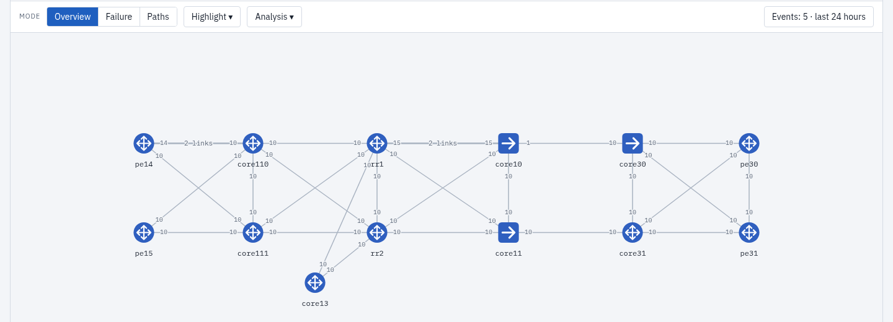
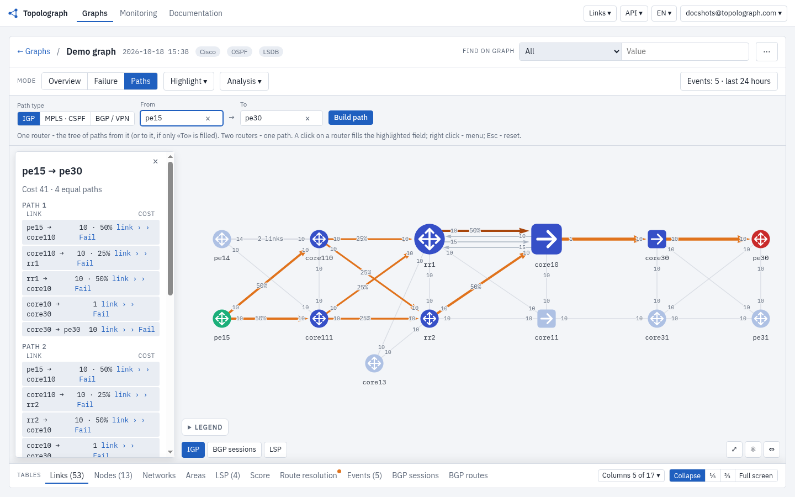
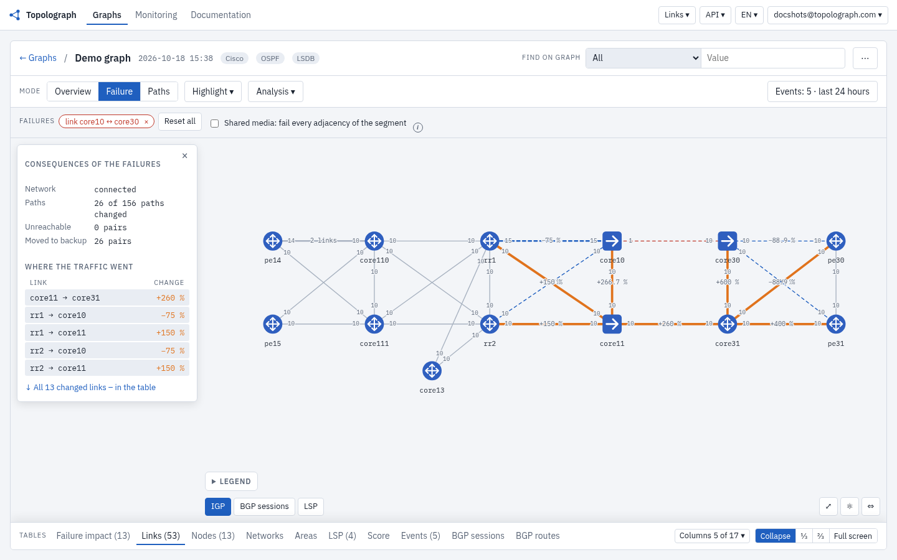
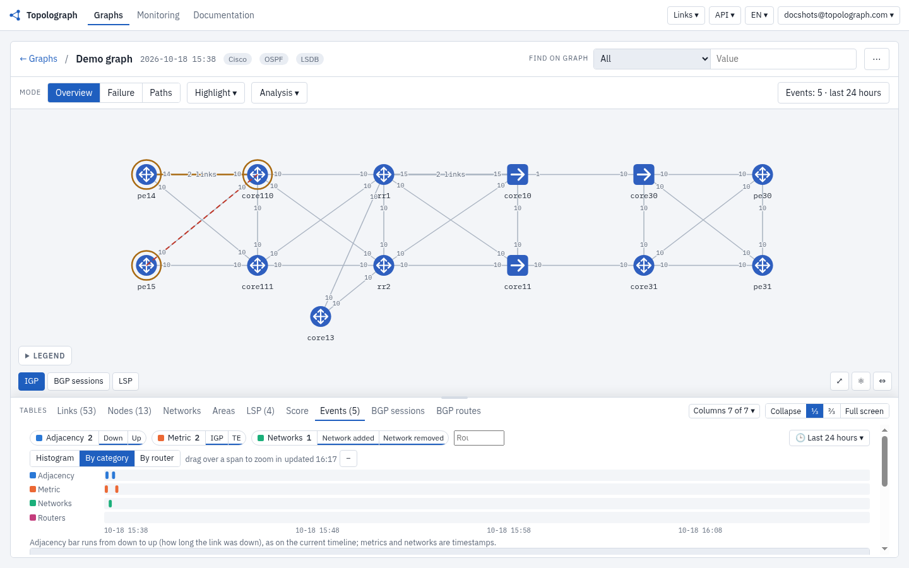
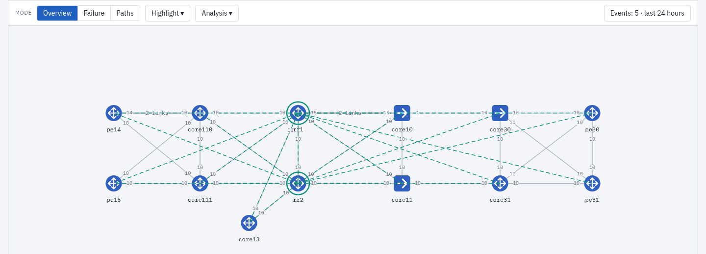
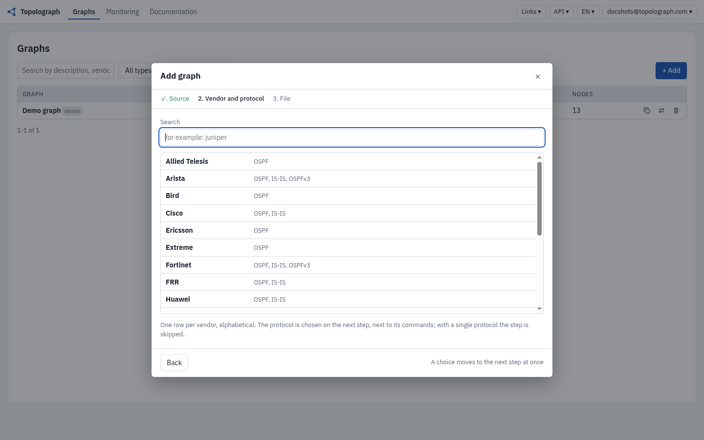
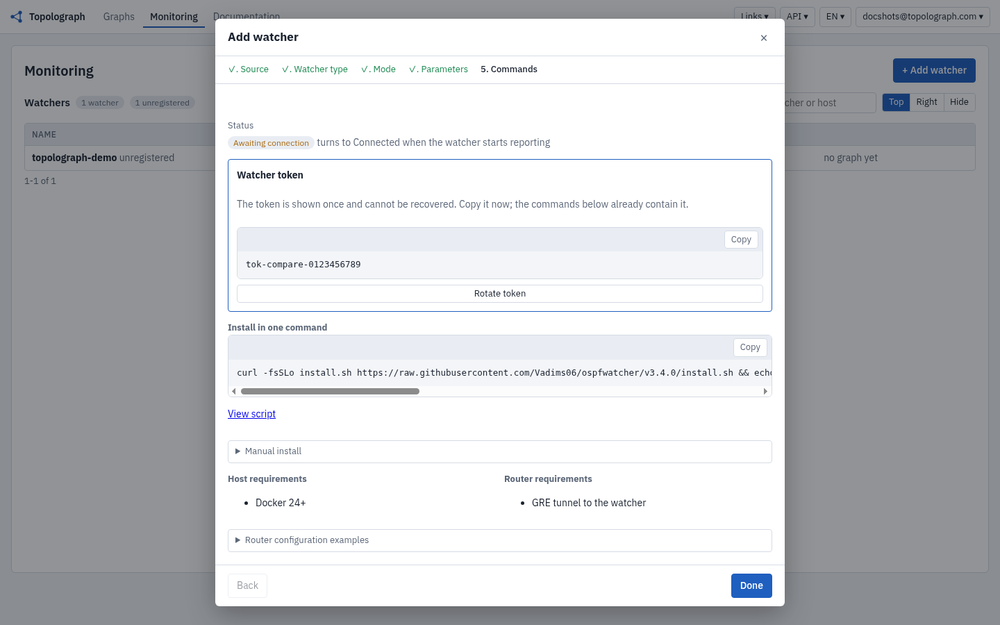

# Topolograph

*Topolograph · routing analysis for network operations*

## Your network, as its protocols see it

Topolograph builds a model of the network from what its routing protocols report: OSPF, OSPFv3, IS-IS and BGP/EVPN. Primary and backup paths, links with no backup, search over network elements (prefixes, MAC addresses and more), and link or node failures simulated before maintenance starts are all computed on that model.

[Interactive demo](https://topolograph.com/graphs?demo=1) · [Self-host with Docker](https://github.com/Vadims06/topolograph-docker) · [Docs](https://docs.topolograph.com)



## Questions Topolograph answers

| Question | How it is answered | Edition |
|---|---|---|
| Why did a prefix disappear? | Comparing the graph at different moments shows when the prefix left the network. | Community |
| Can a link or a device be taken out of service? | Simulating the failure on the graph shows where the traffic goes and which segments are left without a backup, before the work starts. | Community |
| Where will a new MPLS TE LSP with the required bandwidth go? | CSPF over the TE attributes from the LSDB shows the LSP path for the requested bandwidth and how it behaves when a link fails. | Community |
| What changed before the incident? | The collector event history and the graph at the time of the incident show what changed and in which order. | Enterprise |
| Where is the virtual machine with this MAC address now? | An EVPN MAC lookup shows which VTEP or PE advertises it and which path the traffic takes to it. | Community (uploaded data), Enterprise (collector) |
| The interface is up, so why is the adjacency not Full? | The protocol shows that there is no adjacency, and Agent 2.0 checks the cause, for example MTU, with read-only commands from an approved runbook. | Agent |

## How it works

### 1. Snapshot and analysis

The output of the LSDB commands from one router becomes a static snapshot of the network. You work with it offline, without access to the routers: path calculation, search over network elements, maintenance planning. In the demo network (13 routers, 26 links) the pe15 to pe30 path has cost 41 and four equal-cost paths.



Switching off the core10 to core30 link on the model recalculates SPF: traffic moves to core11 to core31, the cost goes from 41 to 50, and there are still four paths. The real network is not touched.



### 2. Continuous monitoring

The collector (watcher) receives routing protocol updates and passes on events about topology changes. It joins the network through an IGP adjacency over GRE, or through BGP-LS (OSPF and IS-IS), or through BMP (BGP). Each event arrives in Topolograph with a timestamp, and the timeline replays the state of the network at any moment: the T0 snapshot and any later state can be compared.





### 3. Investigation with an AI agent

The engineer asks a question in natural language. Agent 1.0 calls the Topolograph MCP server tools for events and failure calculation and answers with a reference to the data. Agent 2.0 runs incident diagnostics by a runbook agreed in advance, with read-only device commands, started manually or automatically from a ticket. See the [AI agent docs](https://docs.topolograph.com/automation/ai-agent/).

## Complements your monitoring

Zabbix, Prometheus, Cacti and Grafana watch devices and interfaces. Topolograph shows how the network routes traffic and works alongside them.

| Capability | Classic monitoring (SNMP/NMS) | Topolograph |
|---|---|---|
| Interface and device state | The main task | Outside the scope: the data stays in the existing monitoring |
| OSPF / BGP neighbor status | Through SNMP or exporters, device by device | From the protocol, for the whole network at once (Enterprise, collector) |
| Topology from the routing protocol | Needs integration or extra development | From the LSDB or the collector (Community / Enterprise) |
| SPF and ECMP paths | Needs separate development | Built in (Community) |
| What-if failures and links with no backup | Usually not available | Built in, on the model (Community) |
| Routing changes over time | Logs and traps of single devices | Events and the topology at the time of the event (Enterprise) |

## Install and connect

* **Hosted:** [topolograph.com](https://topolograph.com). Paste an LSDB or open the [interactive demo](https://topolograph.com/graphs?demo=1).
* **Self-hosted, Community:** run [topolograph-docker](https://github.com/Vadims06/topolograph-docker) in your infrastructure; the routing data stays under your control. Upload an LSDB as a text file, through the API or as YAML.



* **Watchers, Enterprise:** add a watcher from the Topolograph UI (Add, Watcher). Pick the type and the mode (GRE or BGP-LS for OSPF and IS-IS, BMP for BGP); the wizard issues a watcher token and shows one install command. The command downloads `install.sh` pinned to a release, checks its SHA-256 and installs.

 

A watcher can also run standalone, without Topolograph, exporting to ELK, Zabbix, webhooks and Loki. That stays open source: [OSPF Watcher](https://github.com/Vadims06/ospfwatcher), [IS-IS Watcher](https://github.com/Vadims06/isiswatcher), [BMP Watcher](https://github.com/Vadims06/bmpwatcher).

## Community and Enterprise

| | Community | Enterprise |
|---|---|---|
| Price and hosting | Free; self-hosted (Docker) and topolograph.com | Self-hosted or hosted with an on-site collector |
| LSDB upload (text, API, YAML), graph, shortest and backup paths | Yes | Yes |
| Failure and cost what-if, MPLS TE CSPF, BGP/EVPN analysis from uploaded data | Yes | Yes |
| API, SDK, MCP server | Yes | Yes |
| Collectors (OSPF, IS-IS, BMP watchers) feeding Topolograph | Demo graph only | Yes |
| Event history and timeline | Demo graph only | Yes |
| SSO, roles, audit log | No | Yes |
| Alert routing | Event export to ELK, Zabbix, webhook | Alert rules and routing |
| Support | GitHub issues | Priority support |

Enterprise: [contact us](https://topolograph.com/#editions).

## Protocols and vendors

OSPFv2, OSPFv3, IS-IS, BGP-LS, BGP/EVPN over BMP, MPLS TE. LSDB parsers cover the following vendors:

### Supported vendors

Cisco, Cisco NX-OS, Juniper, Nokia, Huawei, ZTE, Arista, Extreme, Ericsson, Fortinet FortiOS, FRRouting, Quagga, Bird, Ruckus, MikroTik, Palo Alto, Ubiquiti, Allied Telesis, IP Infusion OcNOS.

Commands per vendor, protocol and TE attributes: [supported vendors](https://docs.topolograph.com/reference/supported-vendors/).

## Integrations

* **REST API:** the schema is at [topolograph.com/api/ui](https://topolograph.com/api/ui/); examples are in the [docs](https://docs.topolograph.com/automation/).
* **Python SDK:** [topolograph-sdk](https://github.com/Vadims06/topolograph-sdk) ([docs](https://docs.topolograph.com/automation/python-sdk/)).
* **MCP server:** [topolograph-mcp-server](https://github.com/Vadims06/topolograph-mcp-server) exposes the API to LLM agents ([docs](https://docs.topolograph.com/automation/mcp-server/)).
* **AI agent:** [ospf-isis-ai-agent](https://github.com/Vadims06/ospf-isis-ai-agent) ([docs](https://docs.topolograph.com/automation/ai-agent/)).

```python
from topolograph import Topolograph

topo = Topolograph(url="topolograph-url", token="your-api-token")

with open('cisco_lsdb_output.txt') as f:
    graph = topo.graphs.upload(lsdb_data=f.read(), vendor="Cisco", protocol="ospf")

path = graph.paths.shortest("192.168.100.100", "10.1.123.23")
print(path.cost, path.paths)
```

## Documentation and community

* Documentation: [docs.topolograph.com](https://docs.topolograph.com), including analysis reports (heatmap, asymmetric paths, ECMP backup paths), YAML topologies, BMP/EVPN and contribution guides.
* Telegram: [t.me/topolograph](https://t.me/topolograph)
* Issues: [GitHub issues](https://github.com/Vadims06/topolograph/issues)
* Site: [topolograph.com](https://topolograph.com)
