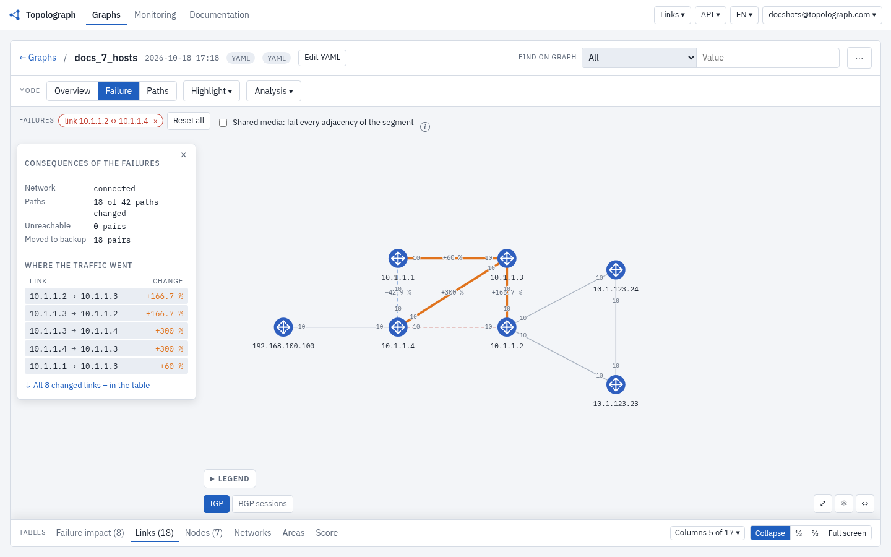
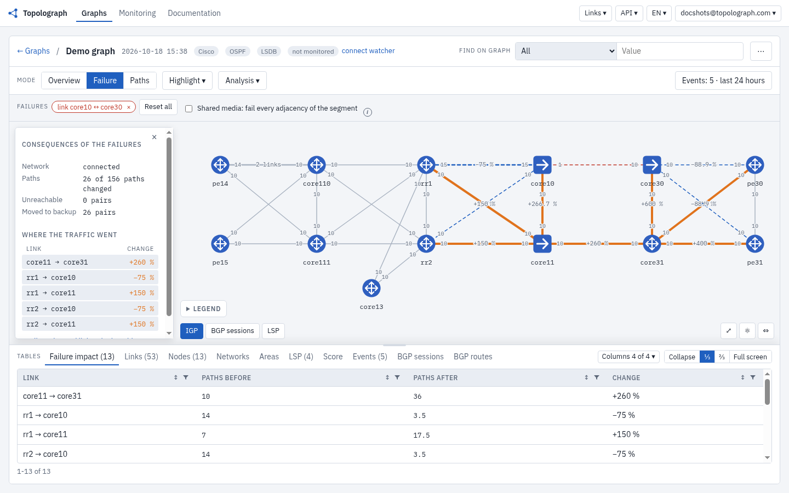
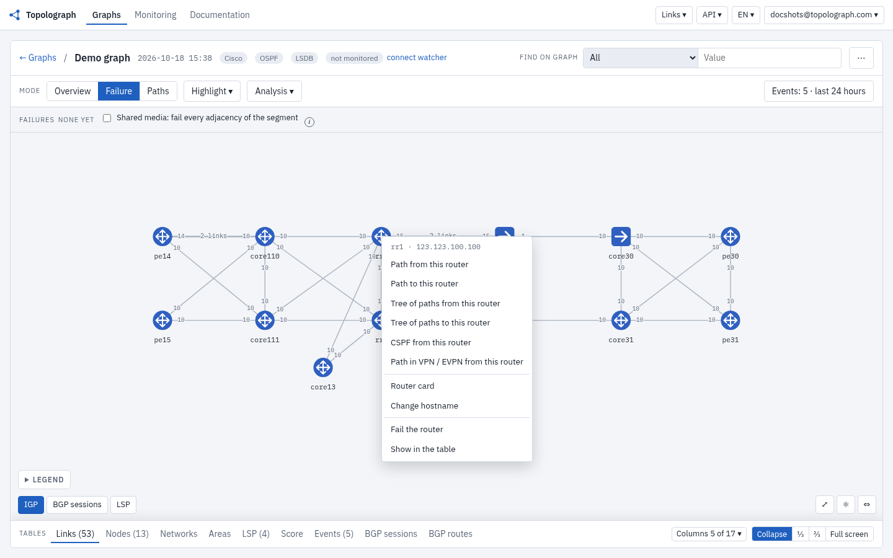
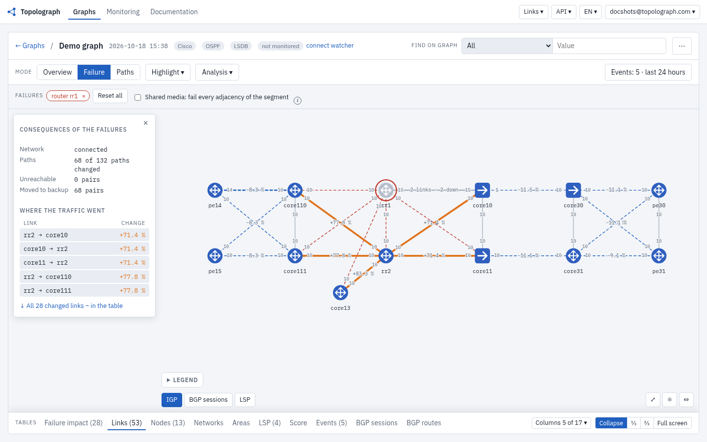
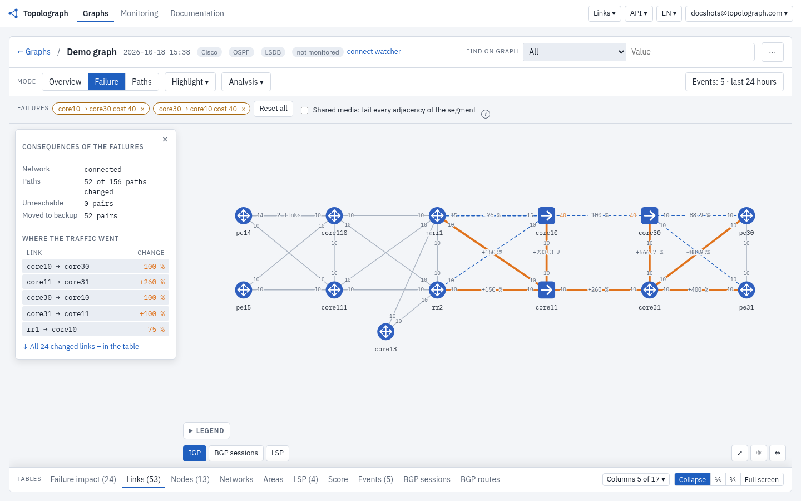
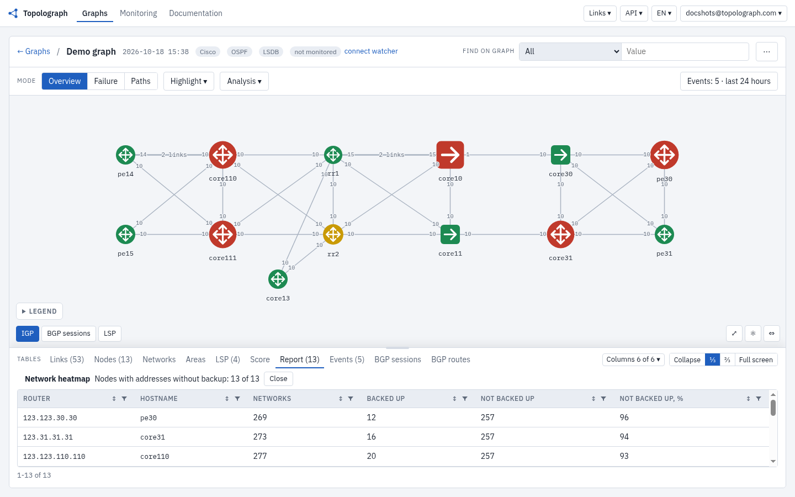
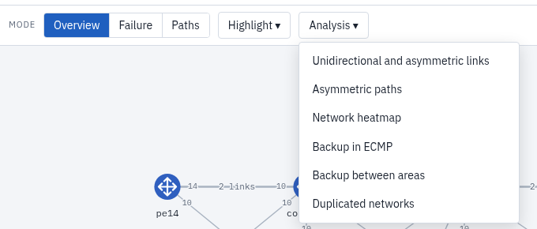
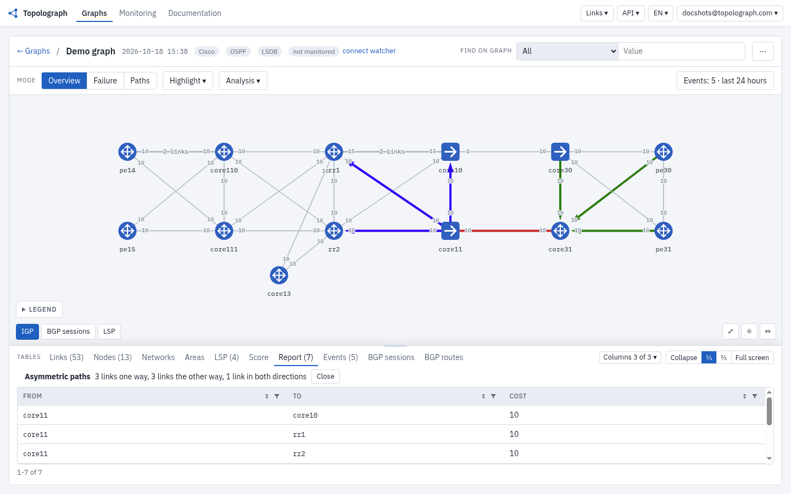

# Visualización y Análisis

Este es el corazón de Topolograph: un grafo interactivo OSPF/IS-IS que puede
examinar con los mismos algoritmos que usan los routers. Todo lo que sigue se
ejecuta sobre su **instantánea** cargada, así que los experimentos nunca
afectan a la red en producción.

## Rutas más cortas

Elija un nodo de origen y uno de destino y Topolograph construye el **árbol
de ruta más corta** entre ellos, resaltando la(s) ruta(s) y mostrando el
costo total del IGP.

Cuando existen varias rutas de igual costo, **ECMP** se muestra
explícitamente para que pueda ver dónde se balancea la carga del tráfico.

## Rutas de respaldo

Topolograph no solo muestra la ruta primaria — calcula la **ruta de
respaldo** que la red usaría realmente si la primaria fallara, incluidos los
respaldos **secundarios**. Esto responde la pregunta que surge en toda
ventana de cambios: *"si este enlace cae, ¿a dónde va el tráfico?"*

También distingue las rutas de respaldo que se apoyan en ECMP de las que no,
lo cual importa al razonar sobre la capacidad durante un fallo.

## Simulación de fallos { #simulating-failures }

Pruebe escenarios hipotéticos sin tocar nada en producción.

### Apagar un enlace

Elimine un enlace y Topolograph recalcula las rutas al instante, mostrando
cómo se redirige el tráfico a su alrededor.

Puede ver el resultado junto con las estadísticas afectadas:

### Apagar un nodo

Simule la caída de un router completo y observe cómo fluye el tráfico
alrededor del nodo fallido. Haga clic derecho en un nodo y elija **Fail the router**.

## Planificación de costos de enlace

Cambie una métrica de IGP al instante y vea de inmediato el efecto en la
selección de rutas — ideal para planificar un mantenimiento, desviar tráfico
de un enlace o validar un diseño de costos antes de aplicarlo.

Asegúrese de seguir en el modo **Failure**. Haga clic derecho en un enlace y elija **Change the cost…**: se abre un formulario. Introduzca el nuevo costo y pulse **Apply**; el resultado del recálculo de rutas se muestra en el grafo de inmediato.

## Mapa de Calor de Red { #network-heatmap }

El **Mapa de Calor de Red** (en **Analysis**) revela de un vistazo las
propiedades estructurales de la topología — qué enlaces y nodos transportan
más rutas, dónde están sus puntos únicos de fallo y qué redes **no tienen
ruta de respaldo**.

Los nodos marcados en rojo concentran la mayor cantidad de redes sin ruta de
respaldo.

Las columnas **Not backed up** del informe cuentan, por router, las redes sin respaldo y muestran exactamente dónde un único fallo causaría una pérdida de alcanzabilidad.

## Detección de rutas asimétricas

El enrutamiento que toma una ruta de ida y otra distinta de vuelta puede
complicar los firewalls, el QoS y la resolución de problemas. El informe
**Analysis → Asymmetric paths** de Topolograph encuentra estos pares por
usted.

## Hacia dónde ir después

-   :material-compare:{ .lg .middle } __Compare dos instantáneas__

    ---

    Vea qué cambió entre capturas.

    [:octicons-arrow-right-24: Comparación de estados](comparing-states.md)

-   :material-tune-variant:{ .lg .middle } __Agregue datos de TE__

    ---

    Ancho de banda, métrica de TE, grupos administrativos.

    [:octicons-arrow-right-24: Traffic Engineering](traffic-engineering.md)

-   :material-radar:{ .lg .middle } __Obsérvelo en vivo__

    ---

    Capture cada cambio a medida que ocurre.

    [:octicons-arrow-right-24: Monitoreo en tiempo real](../monitoring/index.md)

