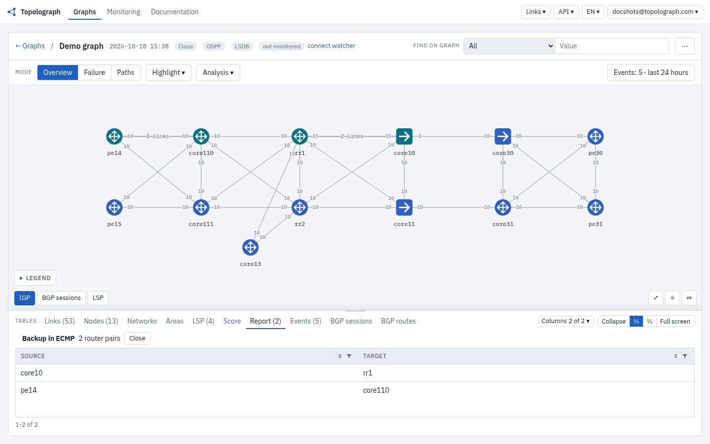

# Visualizing & Analyzing

This is the heart of Topolograph: an interactive OSPF/IS-IS graph you can probe
with the same algorithms the routers use. Everything below runs against your
uploaded **snapshot**, so experiments never affect the production network.

## Shortest paths

Pick a source and a destination node and Topolograph builds the **shortest path
tree** between them, highlighting the path(s) and showing the total IGP cost.

When multiple equal-cost paths exist, **ECMP** is shown explicitly so you can see
where traffic load-balances.

To find the node that terminates a network, start typing the network in the
**Find on graph** field: a dropdown lists all nodes with this network, and
choosing one focuses the graph on that node.

## Backup paths

Topolograph doesn't just show the primary path — it computes the **backup path**
the network would actually use if the primary failed, including **secondary**
backups. This answers the question every change-window raises: *"if this link
goes, where does the traffic go?"*

When you reason about capacity during a failure, all links are counted, whether
or not they belong to an ECMP set.

## Simulating failures { #simulating-failures }

Test "what if" scenarios without changing anything on the live network.

### Shut a link

First switch to the **Failure** mode. There a left-click on a link
changes behaviour — each click simulates an adjacency going down / the link being
removed from the graph. Topolograph recomputes paths instantly and shows how
traffic re-routes around it.

You can see the result together with statistics on the recalculated paths:

### Shut a node

Simulate an entire router failing and watch traffic flow around the failed node.
Right-click a node and choose **Fail the router**.

## Planning link costs

Change an IGP metric on the fly and immediately see the effect on path
selection — ideal for planning network work, draining traffic off a link, or
checking a metric before applying it on the real network.

Make sure you are still in the **Failure** mode. Right-click a link and choose **Change the cost…**: a form opens. Enter the new cost and press **Apply** — the re-routing result shows on the graph immediately.

## Network Heatmap { #network-heatmap }

The **Network Heatmap** (under **Analysis**) reveals structural properties of the
topology at a glance — which links and nodes carry the most paths, where your
single points of failure are, and which networks have **no backup path**.

Nodes marked red carry the most networks with no backup path.

The **Not backed up** columns of the report count, per router, the networks with a single termination point: they attach to only one device, so if that device fails they become unreachable.

## Detecting asymmetric paths

Routing that takes one path forward and a different path back can complicate
firewalls, QoS and troubleshooting. Topolograph's **Analysis → Asymmetric paths** report finds these pairs for you.

## ECMP backup paths

If several links are bundled into an ECMP set and the main link of the set goes down, the backup path is expected to go through the second link of the same set. **Analysis → Backup in ECMP** lists the router pairs where this holds.

## Where to go next

-   :material-compare:{ .lg .middle } __Compare two snapshots__

    ---

    See what changed between snapshots.

    [:octicons-arrow-right-24: Comparing states](comparing-states.md)

-   :material-tune-variant:{ .lg .middle } __Add TE data__

    ---

    Bandwidth, TE metric, admin groups.

    [:octicons-arrow-right-24: Traffic Engineering](traffic-engineering.md)

-   :material-radar:{ .lg .middle } __Watch it live__

    ---

    Capture every change as it happens.

    [:octicons-arrow-right-24: Real-time monitoring](../monitoring/index.md)

