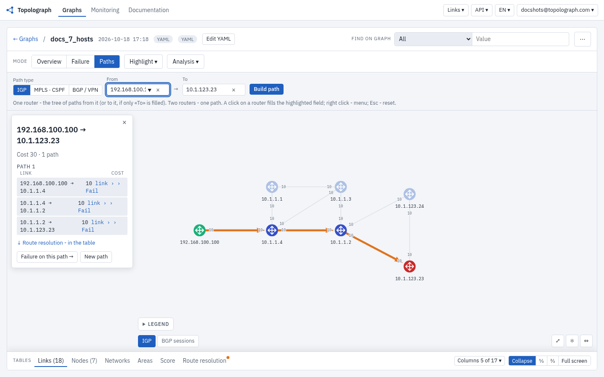
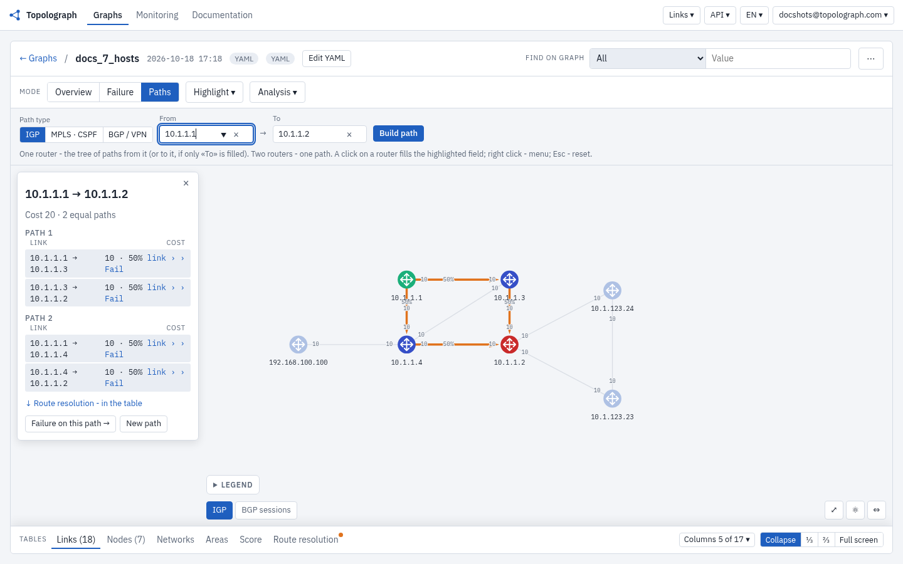

# Automation & APIs

Everything you can do in the Topolograph UI, you can do programmatically. Pick
the surface that fits your workflow:

<div class="grid cards" markdown>

-   :material-language-python:{ .lg .middle } __Python SDK__

    ---

    A Python REST API client, an SSH-based LSDB collector (Nornir), and the
    `topo` CLI.

    [:octicons-arrow-right-24: Python SDK](python-sdk.md)

-   :material-server-network:{ .lg .middle } __MCP Server__

    ---

    Expose the Topolograph API to LLM agents over the Model Context Protocol.

    [:octicons-arrow-right-24: MCP Server](mcp-server.md)

-   :material-robot-happy-outline:{ .lg .middle } __AI Agent__

    ---

    A natural-language assistant that answers questions about your live network.

    [:octicons-arrow-right-24: AI Agent](ai-agent.md)

</div>

## The REST API underneath

All of these are built on Topolograph's REST API. The full, interactive schema
lives at **`/api/ui/`** on your instance (for the hosted service,
[topolograph.com/api/ui](https://topolograph.com/api/ui/)).

A direct upload is as simple as:

```python
import requests

r = requests.post(
    'https://topolograph.com/api/graph',
    auth=('youraccount@domain.com', 'your-pass'),
    json={'lsdb_output': '<your LSDB text>', 'vendor_device': 'Cisco', 'igp_protocol': 'ospf'},
)
```

### Upload a graph

```python
import requests
from pprint import pprint as pp
with open('cisco_lsdb_output.txt') as f:
  lsdb_output = f.read()
  r_post = requests.post('https://topolograph.com/api/graph', auth=('youraccount@domain.com', 'your-pass'),
                          json={'lsdb_output': lsdb_output, 'vendor_device': 'Cisco', 'igp_protocol': 'ospf'})
  pp(r_post.json())
```

`igp_protocol` may include `ospf` or `isis`. Multi-device LSDBs are supported via the API only (v2.34). The response returns:

* a diff with previously uploaded graphs
* a link to get all networks
* the status of passed checks (for example, whether there are asymmetric links in the network)

```
{'diff': {'compared_with_graph_time': '08Jun2021_20h15m26s_13_hosts',
          'graphs_diff': {'all_edges_stats_ll': [{'dst_node': '123.123.110.110',
                                                  'link_cost': 10,
                                                  'link_status': 'old',
                                                  'src_node': '123.123.100.100'],
                          'new_nodes': [],
                          'old_nodes': []},
          'networks_diff': {'new_subnets_attr_dd_ll': [{'rid': '123.30.30.30',
                                                        'subnet': '30.30.30.30/32'}],
                            'old_subnets_attr_dd_ll': []}},
 'graph_time': '08Jun2021_20h15m51s_13_hosts',
 'hosts': {'count': 13},
 'networks': {'backuped': 17,
              'count': 39,
              'notbackuped': 22,
              'url_link': 'https://topolograph.com/api/network/08Jun2021_20h15m51s_13_hosts'},
 'reports': {'ansym_edges_pass_status': False},
 'timestamp': '2021-06-08T20:15:51.724000'}
```

### Shortest path

`GET /api/graph/{graph_time}/path/{node_a}/{node_b}` returns the path cost, the shortest paths and the unbackuped parts of the path (if these links go down, connectivity between the source and destination is lost). Nodes are given by router ID, hostname or IS-IS System ID.

```python
r = requests.get('https://topolograph.com/api/graph/27Dec2022_22h46m01s_7_hosts_ospfwatcher/path/192.168.100.100/10.1.123.23',
                 auth=('', ''))
```

Reply:

```python
r.json()
{'cost': 30,
'spt_path_nodes_name_as_ll_in_ll': [['192.168.100.100', '10.1.1.4', '10.1.1.2', '10.1.123.23']],
'unbackup_paths_nodes_name_as_ll_in_ll': [['192.168.100.100', '10.1.1.4']]}
```

The `'192.168.100.100' - '10.1.1.4'` link is shown as nonbackuped.



### Backup path

`POST /api/graph/{graph_time}/analyse/spt_edge_failure` returns the shortest path when links or routers are down. A link is named by its `edge_key`; ask the edges list for it:

```python
graph = 'https://topolograph.com/api/graph/27Dec2022_22h46m01s_7_hosts_ospfwatcher'
r = requests.get(f'{graph}/edges', auth=('', ''),
                 params={'src_node': '10.1.1.4', 'dst_node': '10.1.1.2', 'include': 'edge_key'})
edge_key = r.json()['items'][0]['edge_key']   # '10.1.1.4|10.1.1.2|ip:10.1.24.4'

r = requests.post(f'{graph}/analyse/spt_edge_failure', auth=('', ''),
                  json={'from': '192.168.100.100', 'to': '10.1.123.23', 'failed_edges': [edge_key]})
```

A failed link is down in both directions; parallel links between the same routers stay up. `failed_nodes` takes routers down, `changed_costs` sets a new cost on one direction of a link.

Reply:

```python
r.json()
{'result': {'cost': 40, 'paths': 1, 'reason': ''},
 'nodes': {'192.168.100.100': {'name': '192.168.100.100', 'role': ['from']},
           '10.1.1.4': {'name': '10.1.1.4', 'role': ['via']},
           '10.1.1.3': {'name': '10.1.1.3', 'role': ['via']},
           '10.1.1.2': {'name': '10.1.1.2', 'role': ['via']},
           '10.1.123.23': {'name': '10.1.123.23', 'role': ['to']}},
 'edges': {'192.168.100.100|10.1.1.4|ip:172.17.0.100': {'role': 'on_path', 'hops': [{'path': 0, 'hop': 0, 'traffic_share': 1.0}]},
           '10.1.1.4|10.1.1.3|ip:10.1.34.4': {'role': 'on_path', 'hops': [{'path': 0, 'hop': 1, 'traffic_share': 1.0}]},
           '10.1.1.3|10.1.1.2|ip:10.1.23.3': {'role': 'on_path', 'hops': [{'path': 0, 'hop': 2, 'traffic_share': 1.0}]},
           '10.1.1.2|10.1.123.23|ip:10.1.123.1': {'role': 'on_path', 'hops': [{'path': 0, 'hop': 3, 'traffic_share': 1.0}]},
           '10.1.1.4|10.1.1.2|ip:10.1.24.4': {'role': 'failed'}}}
```

`hops` orders the links of each path; with several equal-cost paths, `path` tells them apart.


### Shortest path between networks

`GET /api/graph/{graph_time}/path/network` accepts IP addresses and IP networks. Example: a path between `192.1.113.99` and `192.1.213.0/24`.

```python
r = requests.get('https://topolograph.com/api/graph/27Dec2022_22h46m01s_7_hosts_ospfwatcher/path/network', auth=('', ''),
                 params={'src_ip_or_network': '192.1.113.99', 'dst_ip_or_network': '192.1.213.0/24'})
```

Reply:

```python
r.json()
{'cost': 20,
'spt_path_nodes_name_as_ll_in_ll': [['10.1.1.1', '10.1.1.4', '10.1.1.2'], ['10.1.1.1', '10.1.1.3', '10.1.1.2']],
'unbackup_paths_nodes_name_as_ll_in_ll': []}
```



For anything beyond a one-off call, the [Python SDK](python-sdk.md) gives you a
much friendlier interface over the same endpoints.

!!! tip "LLM-friendly by design"
    Topolograph's data model maps cleanly onto natural-language questions, which
    is why the [MCP server](mcp-server.md) and [AI agent](ai-agent.md) exist —
    ask "what's the path between these two IPs?" instead of crafting an API call.
